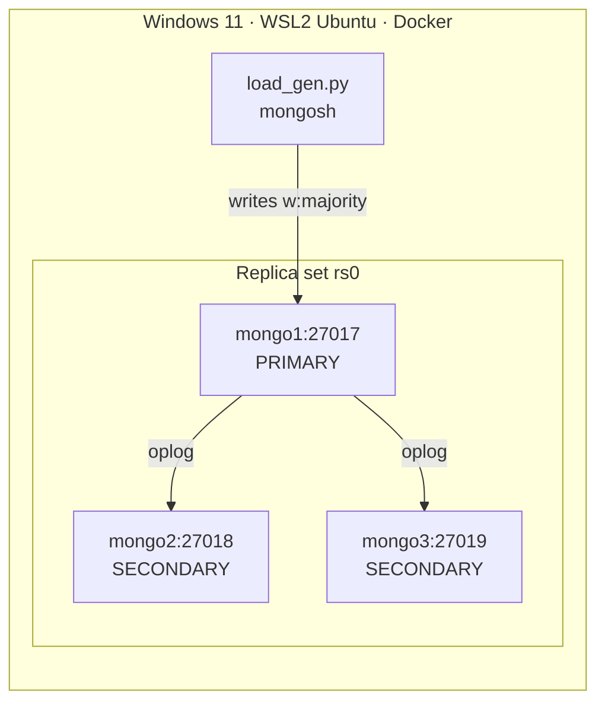

# DB Ops Lab

A hands-on lab for database operations and L2 support: MongoDB replica sets and sharding, backup and disaster recovery, performance troubleshooting, Elasticsearch, and monitoring with Prometheus and Grafana. Everything runs in Docker on a 16 GB Windows laptop (WSL2). Each week I build a stack, break it on purpose, fix it from the terminal, and write a runbook.

## Architecture (week 1)



## Quick start

```bash
cd ~/db-ops-lab/stacks/mongo-replicaset
docker compose up -d
python ~/db-ops-lab/scripts/load_gen.py seed
```

First time on a new machine? See [docs/setup-wsl-docker.md](docs/setup-wsl-docker.md).

## Repo layout

```
db-ops-lab/
├── docs/                    setup notes, diagrams, skills matrix
├── stacks/
│   └── mongo-replicaset/    week 1: 3-node replica set
├── scripts/                 load_gen.py (more each week)
├── runbooks/                one .md per incident (template: _template.md)
└── incidents/               RCA write-ups (template: _template-rca.md)
```

## Incidents I simulated

| Week | Incident | Runbook | MTTR |
|------|----------|---------|------|
| 1 | Primary down | [mongo-primary-down](runbooks/mongo-primary-down.md) | failover 75 ms (clean) / ~11 s (crash), 0 writes lost |
| 1 | Replication lag | [mongo-replication-lag](runbooks/mongo-replication-lag.md) | caught up in ~2 s after fix; both secondaries lagging = silent write stall (16 s, 0 errors) |
| 1 | No primary (lost majority) | [mongo-no-primary](runbooks/mongo-no-primary.md) | |

## Progress

| Week | Focus | Status | Runbooks |
|------|-------|--------|----------|
| 1 | Replica set | in progress | 2 / 3 |
| 2 | Backup & DR | | 0 / 3 |
| 3 | Performance | | 0 / 2 |
| 4 | Sharding | | 0 / 2 |
| 5 | Elasticsearch foundations | | 0 / 3 |
| 6 | Elasticsearch ops & security | | 0 / 3 |
| 7 | Monitoring & alerts | | 0 / 1 |
| 8 | Upgrade & game day | | 0 / 1 |

All incidents here were run in my own lab environment.
